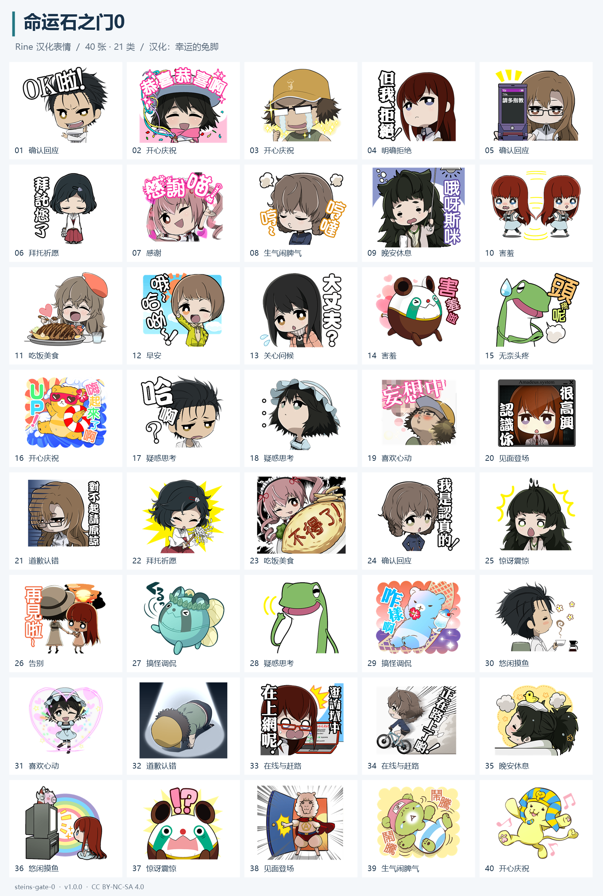

# 命运石之门0

命运石之门0的角色在聊天工具Rine里用到的表情包。汉化作者为幸运的兔脚。

- ID：`steins-gate-0`
- 版本：`1.0.0`
- 汉化署名：幸运的兔脚
- 许可标识：`CC-BY-NC-SA-4.0`，见 [LICENSE.md](LICENSE.md) 与 [来源及署名](ATTRIBUTION.md)
- 内容：40 张原始 PNG，21 个聊天场景分类，每张图片包含中文语义描述和检索标签。

## 致谢与来源

感谢 **[幸运的兔脚](https://rabbitfeet.net/)** 对这套表情包进行中文翻译、修图和嵌字。本仓库使用其汉化版本，原文见 **[《〖汉化〗命运石之门0-Line表情包》](https://rabbitfeet.net/archives/chinese-steins-gate-0-line-sticker/)**。

本仓库对汉化图片进行聊天场景分类，并补充 AstrBot 导入清单、逐图描述、标签和预览；40 张分类图片保留原始字节。原作角色、美术及相关商标的权利归各自权利人所有。完整来源及修改说明见 [ATTRIBUTION.md](ATTRIBUTION.md)。

## 共享协议

本仓库遵循 **[知识共享 署名—非商业性使用—相同方式共享 4.0 国际许可协议（CC BY-NC-SA 4.0）](https://creativecommons.org/licenses/by-nc-sa/4.0/deed.zh-hans)**，与原文页面标注的共享协议一致。

- **署名**：分享时保留汉化作者“幸运的兔脚”、原文链接及许可声明；有修改时注明修改内容。
- **非商业性使用**：仅供非商业目的使用和分享。
- **相同方式共享**：改编后分享的内容继续采用 CC BY-NC-SA 4.0 协议。

完整条款见 [LICENSE.md](LICENSE.md) 和 [协议法律文本](https://creativecommons.org/licenses/by-nc-sa/4.0/legalcode)。

## 导入 AstrBot 表情包管理器

推荐在资源包的 GitHub 安装入口填写本仓库：`Shennoter/astrbot-meme-pack-steins-gate-0`，分支 `main`，包路径 `.`。

也可通过 ZIP 导入：

1. [下载仓库 ZIP](https://github.com/Shennoter/astrbot-meme-pack-steins-gate-0/archive/refs/heads/main.zip)。
2. 打开 AstrBot 的表情包管理器 WebUI，在导入区域选择下载的 ZIP，查看识别结果并确认导入。应识别为“命运石之门0”，共 40 张、21 类，带 40 条语义描述。
3. 在“设置中心 → 使用规则”中选用本包，保存规则。

普通分类模式可直接使用。已附带逐图文字描述；若使用向量检索，再按插件配置生成本机向量。

仓库根目录包含 `manifest.json` 和 `memes/`，附带 v2 分享传输信息。GitHub 下载 ZIP 自带的一层外目录可由插件识别，无需重新压缩。

## 分类

| 分类 ID | 中文名称 | 张数 | 使用场景 |
| --- | --- | ---: | --- |
| `reply` | 确认回应 | 3 | 用于答应、确认收到、自我介绍或认真表态，如“OK”“请多指教”“我是认真的”。 |
| `happy` | 开心庆祝 | 4 | 用于祝贺、喜极而泣、活跃气氛、开心跳舞或庆祝好消息。 |
| `refuse` | 明确拒绝 | 1 | 用于直接拒绝请求或表达不接受，语气带傲娇和吐槽意味。 |
| `pray` | 拜托祈愿 | 2 | 用于诚恳请求、拜托帮忙、祈愿好运，或用驱邪动作表达求平安。 |
| `thanks` | 感谢 | 1 | 用于收到帮助、礼物、关心或称赞后表达感谢。 |
| `angry` | 生气闹脾气 | 2 | 用于轻度生气、不满、傲娇地哼一声，或夸张地闹脾气。 |
| `sleep` | 晚安休息 | 2 | 用于说晚安、准备睡觉、困倦、发烧不适或需要休息。 |
| `shy` | 害羞 | 2 | 用于脸红、不好意思、被夸奖后害羞，或羞于直接表达心意。 |
| `food` | 吃饭美食 | 2 | 用于开饭、展示料理、讨论美食、邀请吃饭或表达对食物的喜爱。 |
| `morning` | 早安 | 1 | 用于早上打招呼、起床报到或向对方问早。 |
| `concern` | 关心问候 | 1 | 用于关切地询问对方是否还好、担心对方状态或温和确认情况。 |
| `sigh` | 无奈头疼 | 1 | 用于遇到麻烦、为难、头疼、无奈或不知道该怎么办。 |
| `confused` | 疑惑思考 | 3 | 用于没听懂、疑惑反问、思考问题或需要对方进一步解释。 |
| `like` | 喜欢心动 | 2 | 用于表达喜欢、可爱、心动、撒娇，或带爱心的幻想和憧憬。 |
| `greeting` | 见面登场 | 2 | 用于初次见面、自我介绍前的问候、欢迎、推门登场或报到。 |
| `sorry` | 道歉认错 | 2 | 用于表达对不起、请求原谅、认错或夸张地土下座致歉。 |
| `surprised` | 惊讶震惊 | 2 | 用于意外、震惊、突然发现问题或对超出预期的信息作出反应。 |
| `bye` | 告别 | 1 | 用于说再见、离开聊天或约定下次再见。 |
| `fool` | 搞怪调侃 | 2 | 用于轻松搞怪、得意展示、玩笑调侃或缓和气氛。 |
| `relax` | 悠闲摸鱼 | 2 | 用于喝咖啡、看电视、放松、享受闲暇或轻松旁观。 |
| `work` | 在线与赶路 | 2 | 用于说明正在上网、在线忙碌、出发、赶路或汇报自己正在路上。 |

分类优先依据图片文字和聊天用途；每张原图只归入一个主分类，其他含义保存在标签和描述中。原编号保留在文件名前缀，完整对应关系见 [分类清单.csv](分类清单.csv)。

## 预览

## 文件说明

- `manifest.json`：包名、ID、简介、许可及分类描述。
- `memes/`：40 张分类图片，文件字节与原包一致。
- `semantic_metadata.json`：逐图描述、可见文字、标签、SHA-256 与条目 ID。
- `memes_data.json`：与清单一致的分类描述兼容文件。
- `meme_pack_export.json`：AstrBot v2 分享导入信息。
- `previews/`：封面、图标与分类总览；只用于展示，不混入表情分类。

图片的可见文字按原图保留繁体写法；图像识别描述和标签采用简体中文。

格式依据：[示例索引仓库](https://github.com/anka-afk/astrbot-meme-pack-index)、[表情包规范](https://github.com/anka-afk/astrbot-meme-pack-index/blob/main/ASTRBOT_MEME_PACK_PROTOCOL_ZH.md)、[示例包](https://github.com/anka-afk/astrbot-meme-pack-example)。
